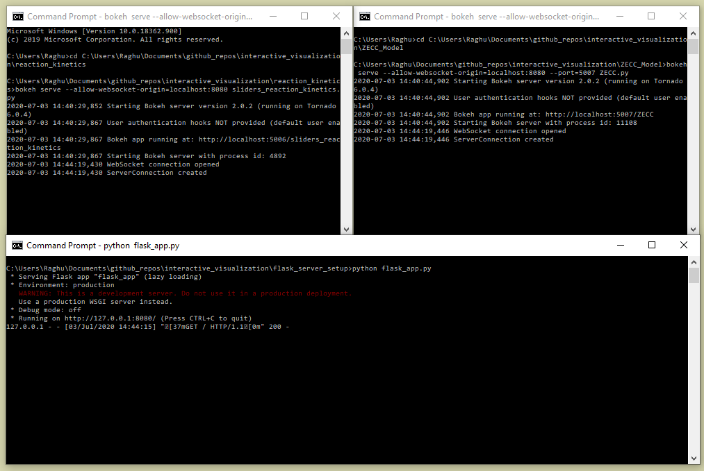
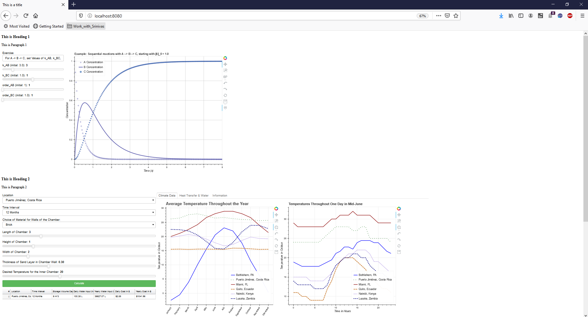

# Flask Server Setup

A quick example showing set up of Flask server consisting of ZECC and reaction_kinetics examples.


### Prerequisites

We are using [Flask](https://pypi.org/project/Flask/) to embed multiple interactive visualizations in a HTML webpage. You can install Flask using:

```
$pip install flask
```

### Setup

Step 1: Open a command line. Navigate to the repository folder reaction_kinetics in your local machine. Run the reaction kinetics example using:

```
bokeh serve --allow-websocket-origin=localhost:8080 sliders_reaction_kinetics.py 
```

Step 2: Open a command line. Navigate to the repository folder ZECC in your local machine. Run the ZECC example using:

```
bokeh serve --allow-websocket-origin=localhost:8080 --port=5007 ZECC.py 
```

Step 3: Run the Flask server using:
```
python flask_app.py 
```

Step 4: Navigate to localhost:8080 to see the HTML setup.

Below is a link to the screenshot of command line commands in the repository.



The final output on your local machine should appear as:



## SINDy module

SINDy uses the same filename-based Bokeh setup as the existing modules. Run
the backend from the module directory so its built-in `data/` paths resolve:

```bash
cd SINDy
pip install -r requirements.txt
bokeh serve SINDy.py --allow-websocket-origin=localhost:8080
```

In a second terminal, start the parent Flask application and open
`http://localhost:8080/SINDy`:

```bash
python flask_server_setup/app/flask_app.py
```

In production, the parent page is `/app/SINDy` and the Bokeh app is `/SINDy`,
matching the route convention already used by ZECC, SIR, and the other working
modules. The system administrator only needs to run the Bokeh serve command in
the backend. See [`../SINDy/DEPLOYMENT.md`](../SINDy/DEPLOYMENT.md).
